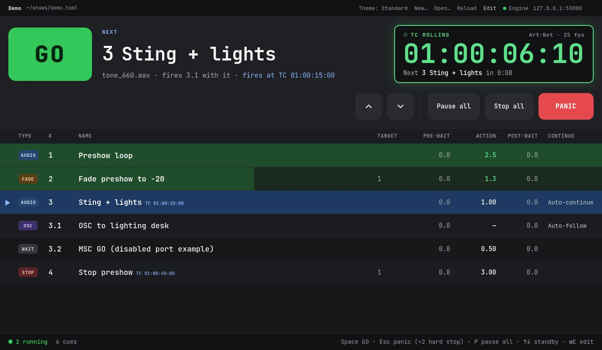
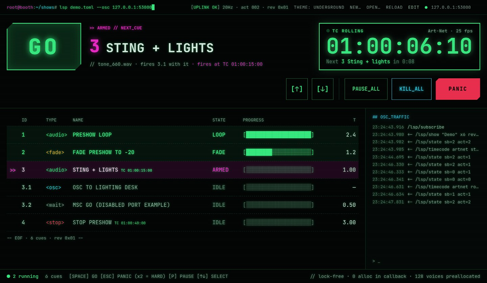
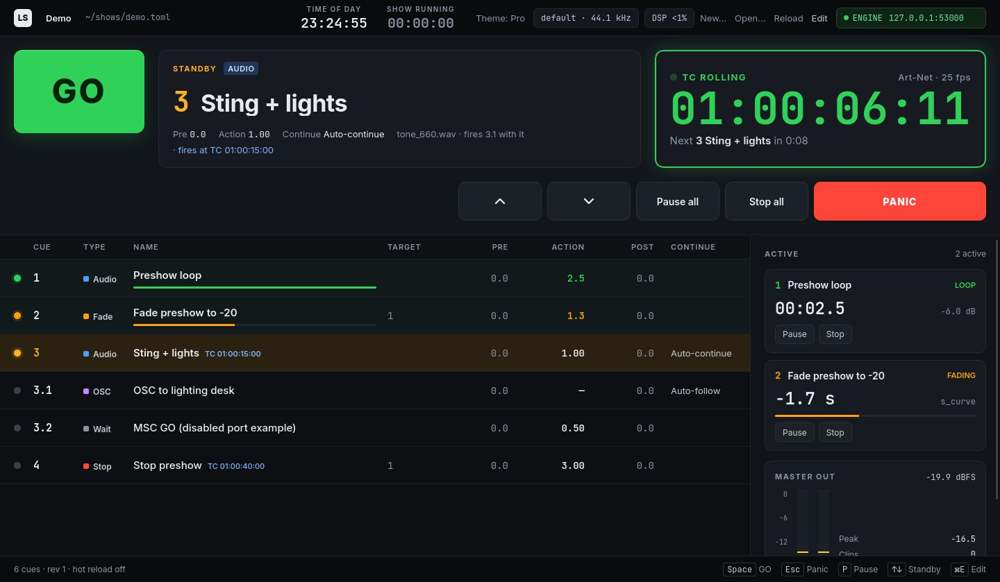
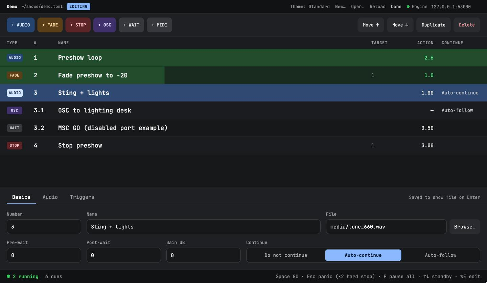

# showplayer-rs

Cue-based show playback engine for macOS + Linux, modelled on [Linux Show Player](https://www.linux-show-player.org/).
Headless engine first — every UI (Tauri, egui, TouchOSC, Q-SYS, Stream Deck) is just an OSC client.



- **Real-time audio engine** in Rust: lock-free mixer, preloaded clips, GO latency of one audio buffer
- **Cue types**: audio, fade, stop, OSC, MIDI/MSC, wait — with pre/post-waits, auto-continue and auto-follow
- **Timecode triggers**: cues fire from incoming MTC or Art-Net timecode
- **Show safety**: second-trigger policy, pause/resume, hard stop, double-panic, broken-cue detection
- **Live editing**: edit cues from the UI while the show runs; the TOML show file stays the source of truth (comments kept)
- **Hot reload**: save the show file and running cues keep playing
- **OSC everywhere**: control and state feedback (cue list, progress, output meters) for any remote surface
- **Operator UI** (Tauri) with three themes

| Underground | Pro |
|---|---|
|  |  |
| Terminal look: cue STATE column, ASCII progress bars, live **OSC_TRAFFIC** log of what the UI sends and receives | Broadcast console: time-of-day and show-running clocks, device / DSP chips, Active panel, **MASTER OUT** meter with real engine levels |

## Layout

```
crates/
  lsp-core/    show model (TOML), cue types, Command enum — no I/O
  lsp-audio/   cpal output thread, lock-free mixer (rtrb SPSC), symphonia decode + SRC
  lsp-engine/  `lsp` binary: sequencer (timer heap), OSC server/client + feedback, MIDI out, stdin console
ui/            Tauri operator UI (separate workspace) — an OSC client of the engine
shows/         demo.toml + generated test tones
```

## Build / run

```bash
# Linux deps
sudo apt install libasound2-dev pkg-config        # + libjack-jackd2-dev for --features jack

cargo build --release
./target/release/lsp --list-devices
./target/release/lsp shows/demo.toml               # <enter> = GO
./target/release/lsp                               # no show: waits for /lsp/load (or `load <path>` on stdin)
./target/release/lsp shows/demo.toml --no-watch    # don't hot-reload on file change (e.g. during performance)
./target/release/lsp shows/demo.toml --host JACK --device system   # needs --features jack
```

## OSC API (default udp/53000)

| Address | Args | Action |
|---|---|---|
| `/lsp/go` | – | fire standby cue, advance playhead |
| `/lsp/stop` | `[cue]` | stop cue (uses its `fade_out`) or all |
| `/lsp/hardstop` | `[cue]` | stop immediately (10 ms declick) — cue or all |
| `/lsp/pause` / `/lsp/resume` | `[cue]` | freeze / continue a cue or everything (audio, pre-/post-waits, durations) |
| `/lsp/panic` | – | clear timers, fade all (`panic_fade`); **a second panic during the fade hard-stops** |
| `/lsp/goto` | `cue` | set standby |
| `/lsp/next` / `/lsp/prev` | – | move playhead |
| `/lsp/status` | – | log standby + running |
| `/lsp/load` | `path` | load a show file (path on the engine host) |
| `/lsp/reload` | – | re-read the current show file |
| `/lsp/new` | `path [name]` | create an empty show file and load it (never overwrites) |
| `/lsp/edit` | `json` | edit the show (see **Editing**); reply `/lsp/edit/reply json` to the sender |
| `/lsp/subscribe` | `[reply_port]` | receive feedback (renew every <10 s) |
| `/lsp/unsubscribe` | `[reply_port]` | stop feedback |
| `/lsp/cuelist` | `[reply_port]` | re-send the cue list to the caller |

```bash
oscsend localhost 53000 /lsp/go          # liblo-tools
```

### Feedback

Subscribers get packets from the engine's OSC port, sent to the subscriber's source address (or `reply_port` on the same host, handy for TouchOSC). The cue list is sent on first subscribe; state is pushed at 20 Hz while anything runs and 1 Hz when idle (doubles as a heartbeat).

| Address | Args |
|---|---|
| `/lsp/show` | `name:s count:i path:s rev:i` |
| `/lsp/cue` | `idx:i number:s name:s type:s duration:f next:s pre_wait:f post_wait:f problem:s second_trigger:s data:s` (`data` = the cue as JSON) |
| `/lsp/state` | `standby:i` then `[idx:i phase:s elapsed:f duration:f]` per active cue |
| `/lsp/load` | `status:s path:s message:s` — `loading` · `ok` · `error` |
| `/lsp/meter` | `peak_l:f peak_r:f clips:i load:f subs:i` — linear output peaks and clip count since the previous message, worst audio-callback load (0–1), feedback clients; sent with every state push |
| `/lsp/engine` | `device:s rate:i channels:i max_voices:i watch:i` — on subscribe |
| `/lsp/timecode` | `source:s status:s tc:s rate:s message:s` — `off`/`mtc`/`artnet`; `off` · `waiting` · `rolling` · `stopped` · `error`; last reading `HH:MM:SS:FF`; what is listened to, or the error; sent with every state push |

`standby` = -1 at end of list. `duration` = -1 for looping audio. `phase` = `pre_wait` · `running` · `paused` · `stopping`. `problem` is empty for a healthy cue, otherwise why it would misbehave (missing media, missing/non-audio target, bad OSC host, duplicate number).

## Operator UI (Tauri)

```bash
./target/release/lsp shows/demo.toml               # engine, in one terminal
cd ui/src-tauri && cargo run --release              # UI; --engine host:port or LSP_ENGINE to target a remote engine
```

- **Themes**: Standard, Underground, Pro — switch with **Theme** in the top bar (remembered per machine).
- **Run mode**: GO with the standby cue and what it will do, cue list with live progress, Pause all, Stop all, Panic (twice = hard stop), per-cue pause / stop, click a cue to set standby.
- **Warnings**: broken cues are marked ⚠ with the reason; the standby line warns when GO will be ignored.
- **Shows**: New… / Open… / Reload with load status. Open… sends the picked path to the engine, so it only works when the engine sees the same path (same machine or shared mount).
- **Keys**: Space GO · Esc panic (twice = hard stop) · P pause / resume all · ↑↓ move standby · ⌘E edit · ⌘O open · ⌘R reload.
- **Build**: the front end is static HTML/JS in `ui/dist` (no npm). For a `.app` bundle: `cargo install tauri-cli --version '^2' && cd ui/src-tauri && cargo tauri build`.

## Show loading / hot reload

- Loads run on a worker thread; running cues keep playing while media decodes.
- Clips are cached by path + mtime: a reload only decodes media that changed.
- The show file is polled every 500 ms and reloaded when it changes (`--no-watch` to disable).
- A file that fails to parse is reported (`/lsp/load error`, with line/column) and the current show stays live.
- Reloading the **same file** keeps running cues, matched by cue number (insert/renumber/edit freely); standby follows its cue number. Cues removed from the file fade out with their `fade_out`.
- Loading a **different file** fades out everything running and resets standby to the first cue.
- `osc_listen` / `audio_device` changes need an engine restart (logged as a warning).

## Editing

The show file stays the source of truth. Edits are applied to the TOML with `toml_edit` (comments and formatting are kept), validated by parsing the result, written atomically, and reloaded through hot reload — running cues keep playing. Every edit names the show revision it was made against (`rev` from `/lsp/show`); a stale edit, or one made while the file changed on disk, is refused.

```json
{"op":"add",       "rev":3, "after":0, "type":"audio", "fields":{"file":"/abs/or/relative.wav"}}
{"op":"update",    "rev":4, "idx":1, "fields":{"number":"2.5", "gain_db":-6, "loop":null}}
{"op":"delete",    "rev":5, "idx":1}
{"op":"duplicate", "rev":6, "idx":0}
{"op":"move",      "rev":7, "idx":2, "to":0}
```

- `null` resets a field to its default (removes it from the file).
- New cues get an automatic number: next integer if free, else a midpoint (`1` → `1.5`).
- Renumbering a cue retargets fade / stop cues that pointed at it, and a running cue keeps playing.
- Media paths under the show's folder are stored relative to it.
- Refused: duplicate numbers, fields that don't belong to the cue type, anything that wouldn't parse.

In the UI, **Edit** (⌘E) switches to edit mode: click selects, double-click sets standby, the inspector edits the selected cue (changes apply on Enter / blur), and the toolbar adds, duplicates, moves and deletes (⌫ twice). **New…** creates a show.



## Safety

- **Second trigger** (`second_trigger` on any cue): what GO / a chain does when the cue is already running — `ignore` (default; standby still advances), `stop` (own fade-out), `hard_stop`, `restart`.
- **Fade curves** (`curve` on audio and fade cues): `s_curve` (default), `equal_power`, `linear`.
- **Pause** freezes audio (declicked), pre-waits, post-waits and fade/wait durations; elapsed time excludes the pause. Stopping a paused cue ends it at once (it's silent).
- **Panic ×2**: Esc / panic fades everything over `panic_fade`; a second panic during that fade hard-stops.
- **Broken cues** are flagged at load and shown in the UI before you fire them.

```toml
[[cue]]
number = "2"
type = "audio"
file = "media/sting.wav"
second_trigger = "restart"
curve = "equal_power"
```

## Timecode triggers

Any cue can fire from incoming timecode, from a DAW, video server or lighting desk:

```toml
[settings]
timecode = "mtc"            # off (default) | mtc | artnet
# mtc_port = "Scarlett"     # MIDI input, name contains; default = first non-"Through" port
# artnet_listen = "0.0.0.0:6454"

[[cue]]
number = "5"
type = "audio"
file = "media/hit.wav"
timecode = "01:00:12:10"    # HH:MM:SS:FF
```

- **Sources**: MTC (quarter-frame and full-frame SysEx) on a MIDI input, or Art-Net **ArtTimeCode** packets (OpCode 0x9700). 24, 25, 29.97 drop-frame and 30 fps. The rate comes from the stream.
- **Firing**: a cue fires when timecode *rolls forward* past its time, through the normal trigger path (pre-wait, second-trigger policy, chaining). Standby moves past it as with GO.
- **Locate**: a stop, rewind or jump of more than one second moves the position without firing the cues it skipped. Roll back before a cue to fire it again.
- GO, stop and panic still work while timecode runs. To rehearse without timecode, set `timecode = "off"`.
- The listener starts when a show loads and restarts when these settings change. If it fails (port in use, MIDI device missing), the error appears in the UI and log; reloading the show retries. `lsp --list-devices` lists MIDI inputs.
- In the UI the **TC** readout in the top bar shows the incoming time (green while rolling). Cues with a trigger are tagged in the cue list, and the time is set in the inspector's **Triggers** tab.

## Cue types

`audio` · `fade` · `stop` · `osc` · `midi` (raw bytes → MSC/notes/PC) · `wait`
Chaining: `next = "auto_continue"` (fires next after `post_wait` from start) | `"auto_follow"` (fires on natural end). `pre_wait` on any cue.
See `shows/demo.toml`.

## RT design notes

- Audio callback: no locks, no alloc. Voices preallocated (128). Finished clips are returned through the event ring so the final `Arc` drop happens on the control thread.
- All audio is decoded + resampled to device rate at show load (preload), so GO latency is one callback period.
- cpal `Stream` is `!Send` on macOS → owned by a dedicated thread, parked until shutdown.
- Linear SRC: adequate for cues; swap in `rubato` for higher quality.

## Roadmap

- [x] OSC feedback (`/lsp/state` push to subscribers) for remote UIs
- [ ] Multichannel routing (cue → output bus matrix), per-cue patch
- [x] Timecode cue triggers (MTC, Art-Net ArtTimeCode)
- [ ] LTC input; chase (audio position follows timecode)
- [x] Show load over OSC, hot reload of show file, file watcher
- [x] Tauri UI: cue list, GO, progress, stop/panic over OSC
- [x] Cue editing (add / update / delete / duplicate / move) over OSC + UI inspector
- [x] Output level meters (lock-free peaks from the audio callback)
- [ ] UI: drag-to-reorder, multi-select, undo
- [ ] Phone remote (web page served by the engine)
- [ ] Group cues, playlist mode
- [ ] Streaming decode for long files (> RAM budget)
